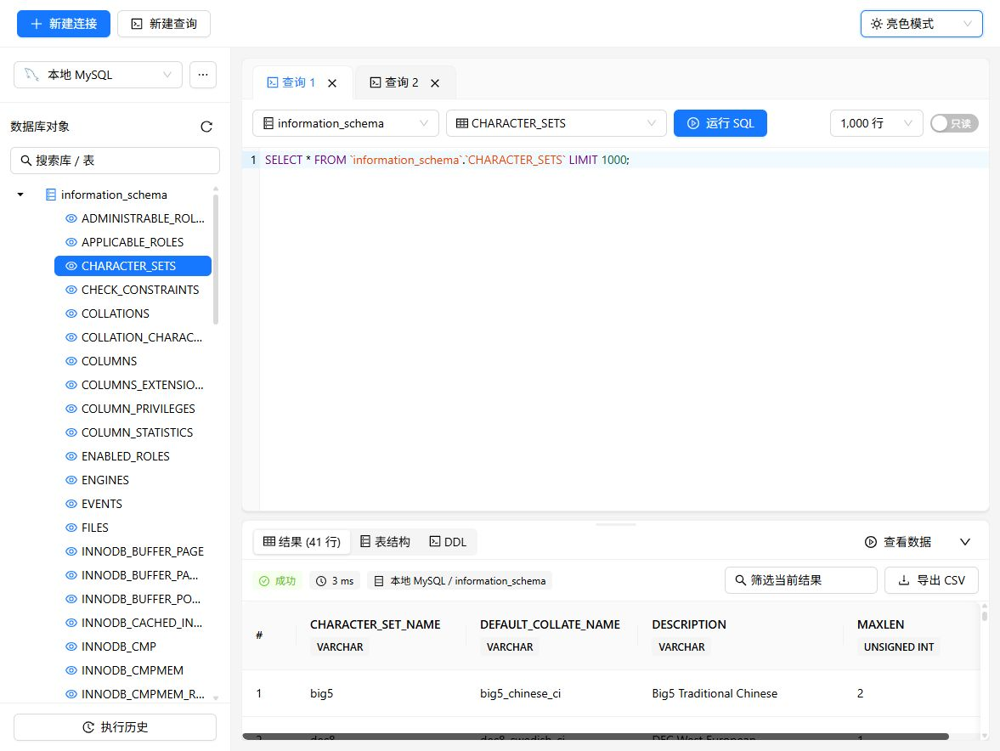

# SQL Studio

一个面向本机单人使用的简易数据库工作台，采用 **Vite + React + TypeScript + Ant Design** 前端和 **Go + Gin** 后端。数据库访问使用 MySQL 驱动，前后端独立目录，生产模式由 Go 同时提供网页和 API。



[查看暗黑模式截图](docs/preview-dark.png)

## 已实现

- MySQL 连接配置；默认初始化本机 `root@127.0.0.1:3306`。
- 按前端 design 参考图整理连接窗口：类型侧栏、常规/SSL 表单、独立操作栏、必填校验与连接测试反馈，支持校验证书的 TLS。
- 左侧为连接 → 数据库 → 表/视图的完整树，点击箭头或双击节点按需加载/收起；成功后点亮连接，右键支持打开/关闭、刷新、编辑、删除。右侧连接/库下拉与树联动，表通过树选择，只提供已加载成功的连接；每个查询标签独立保存范围和草稿。
- 参考 ghspace 的 Ant Design 主题算法，提供亮色、暗黑、跟随系统三种选项并保存偏好；普通文字亮色用黑色、暗色用白色，字体使用 Ant Design/系统默认。
- 加高 SQL 编辑区，有结果时直接展示底部面板，默认高度 260px，可拖动上边缘调整大小及双击恢复默认高度；面板和对象树独立滚动。
- 顶栏集中新建连接/新建查询；运行工具栏右侧提供本地 SQL 导入、完整草稿导出。结果状态和耗时使用图标与文字，字段类型与 NULL 不使用 Tag，移除连接来源标签。
- 信息 Tag 使用蓝色 solid，状态使用语义色；按钮保持 Ant Design 默认样式；数据库采用既有品牌 Logo，历史入口位于导出之后，以 Table 分页展示，搜索与分页固定，行详情默认折叠；执行按钮位于连接/库选择之后。
- 全局与页面使用 SCSS，入口保留 Ant Design reset；主色直接使用组件 primary token，SQL 编辑器继承页面系统字体。连接类型仅用 primary 背景选中，内容区固定高度且左右独立滚动，页签切换不推动底部操作栏。
- 字段名、类型、NULL、主键、默认值、注释与 DDL。MySQL 使用 SHOW CREATE。
- SQL 高亮编辑器、当前表字段补全、多查询标签、SQL 草稿自动保存。
- 执行全部 SQL 或选中的片段，快捷键 `Ctrl+Enter`（Mac 可用 `Cmd+Enter`）。
- 前端查询固定使用后端默认只读事务；移除行数上限选择和写入模式入口及相关前端状态/参数。
- 查询结果分页、筛选、CSV 导出、耗时、影响行数、错误反馈、取消请求。
- 最近 50 条执行历史，可按 SQL / 数据库搜索并载入新标签重跑。
- 查询最长 30 秒；前端使用后端默认 1,000 行返回上限，最多约 8 MiB 字段内容；最多同时执行 4 个查询。
- BIGINT / DECIMAL 作为字符串返回以避免 JavaScript 精度损失；NULL 保留为 NULL；二进制字段展示为 `0x...`。

## 开发入口与规范

[前端源码索引](sql-web/src/README.md) · [后端包索引](sql-server/internal/README.md) · [项目 skill](.agents/skills/sql-studio/SKILL.md) · [AGENTS 指引](AGENTS.md)

组件、自定义 hook 和普通模块采用独立目录、源码入口与 README；后端按 Go 包维护说明和注释。`pnpm lint` 包含前端结构/链接检查，后端架构测试校验依赖及包文档；整体归档可运行 `node scripts/check-structure.mjs`。

## 目录

```text
C:\Users\Lenovo\Desktop\sql
├─ sql-web/                   # 前端（复用原有 Vite 骨架）
│  ├─ src/App.tsx             # 应用入口与 Ant Design 全局配置
│  ├─ src/pages/workspace/    # SQL 工作区、页面组件、交互类型和样式
│  ├─ src/services/           # 数据库 API 调用
│  ├─ src/typings/            # 前后端共享契约
│  ├─ src/utils/              # 请求、浏览器存储、SQL 和 CSV 工具
│  ├─ .prettierrc             # 与 ghspace 前端对齐的格式规则和 import 排序
│  └─ vite.config.ts          # 本机 5173，/api 代理到 8080
├─ sql-server/                # Go 后端
│  ├─ cmd/sql-studio/         # 启动入口
│  ├─ internal/app/           # 应用装配、HTTP 生命周期
│  ├─ internal/config/        # 环境变量与启动参数
│  ├─ internal/httpapi/       # 路由、请求响应、同源校验
│  ├─ internal/service/       # 业务规则、查询限制与超时
│  ├─ internal/model/         # 连接、结构、SQL 数据契约
│  ├─ internal/mysql/         # MySQL 连接、结构读取与执行
│  ├─ internal/connection/    # 本地加密连接仓库
│  ├─ tests/integration/      # 真实 MySQL 集成测试
│  ├─ tests/architecture/     # 分层依赖约束测试
│  └─ data/                   # 运行时生成，已忽略提交
├─ docs/API.md                # API 与请求示例
├─ docs/VERIFICATION.md       # 实际验证记录与边界
├─ docs/DEVELOPMENT.md        # 目录职责、格式规则、编辑器配置
├─ .editorconfig             # UTF-8、LF、缩进规范
```

## 环境与首次安装

本机验证环境：Node.js 24.19.0、pnpm 12.5.1、Go 1.26.0、MySQL 8.4.10（WSL）。前端版本以 `sql-web/pnpm-lock.yaml` 为准；Go 驱动版本固定在 `sql-server/go.mod`。

在 PowerShell 中执行：

```powershell
cd C:\Users\Lenovo\Desktop\sql\sql-web
pnpm install
cd ..\sql-server
go mod download
cd ..
```

MySQL 保持 WSL 中已启动状态。当前仅支持 MySQL，可在连接窗口填写实际地址和账号，支持范围见 [数据库连接说明](docs/DATABASES.md)。Redis 暂不依赖，也不修改其配置。

## 启动

前后端在两个终端分别启动，使用原生命令，不再提供 PowerShell 启停包装脚本。


```powershell
# 终端 1
cd C:\Users\Lenovo\Desktop\sql\sql-server
$env:SQLDESK_MYSQL_PASSWORD = '00000000'
go run ./cmd/sql-studio

# 终端 2
cd C:\Users\Lenovo\Desktop\sql\sql-web
pnpm dev
```

初次运行时，后端根据环境变量初始化本机连接；已保存的连接不会被启动参数覆盖。也可通过网页顶栏「新建连接」手动配置和测试，已有连接通过树根右键菜单编辑。

## 使用步骤

1. 点击左侧连接箭头，成功加载结构后连接点亮；右键可关闭、刷新、编辑或删除。编辑密码留空会保留原密码。
2. 在右侧选择已加载连接、数据库，或点击树节点同步范围；只有展开箭头或双击连接/库节点才加载列表。选择表会加载字段和 DDL。
3. 右键表「查询数据」直接执行只读 SELECT，「新建查询」生成 SQL；也可自行输入 SQL 并点「运行」，选中片段时仅执行选中内容。顶部和数据库菜单的新建查询为空白。
4. 结果底部每页显示 50 行，索引固定左侧，分页靠右；筛选仅作用于已返回的结果，CSV 导出筛选后的全部已返回行。
5. 前端使用后端默认只读模式，不提供写入入口。关闭连接清空该连接下所有查询的连接/库/表选择，保留 SQL 草稿和已有结果；重新连接后需重新选择范围。

可直接运行的示例：

```sql
SELECT VERSION() AS database_version, CURRENT_USER AS connected_as, NOW() AS server_time;
-- 下面这条仅适用于 MySQL / MariaDB / PolarDB MySQL：
SHOW DATABASES;
```

请每次分别执行一条，或只选中其中一条。每次请求仅支持一条 SQL，不支持脚本批量执行、`USE` 持久化会话、`DELIMITER`、过程脚本批量导入或多结果集。

## 保存方式与使用边界

- 连接配置保存到后端 `sql-server/data/connections.json`，密码字段使用 AES-256-GCM 随机 nonce 加密，密钥位于同目录 `master.key`。连接查询 API 不返回密码。
- **加密是本地文件级保护**：持有数据文件和密钥的人仍可解密，不等同于操作系统凭据保险箱。备份和迁移请将二者作为敏感文件共同保管。丢失密钥时后端会拒绝启动，避免覆盖已有配置。
- SQL 草稿和执行历史在当前浏览器 localStorage，历史包含 SQL 文本，不包含结果或连接密码。SQL 中手写的敏感值仍会进入草稿和历史；可在界面清空历史，关闭查询标签删除对应草稿。
- 默认 `root` 使用了当前本机已有账号。可以在连接管理中换成权限较低的专用数据库账号。只读事务由 MySQL 强制执行，不替代数据库账户权限控制。
- 服务固定监听 `127.0.0.1:8080`，无登录/多用户机制。拒绝非本机 Host、跨源 API 请求，不适合直接开放到局域网或公网；SSL 分页可以启用校验证书与主机名的 TLS，暂不支持自定义 CA 文件及 SSH 隧道。
- 每次 SQL 请求使用独立连接。取消/超时会关闭对应数据库连接；**若取消的是写入，需查询数据库确认最终状态，不能假定已回滚**。结果行数/大小限制只控制返回量，复杂 SQL 的数据库计算仍由其执行计划决定。
- 前端当前仅支持只读查询；暂未提供 Navicat 的可视化表设计器、单元格编辑、数据导入、SQL 格式化和账号体系等。

## 检查

前后端统一格式化和只检查（检查不会修改文件）：

```powershell
cd C:\Users\Lenovo\Desktop\sql
gofmt -w .
gofmt -l .
```

前端格式参考桌面 `ghspace/ghspace-polardb-web`：单引号、无分号、无尾逗号、200 字符行宽和自动 import 分组排序。Go 使用标准 `gofmt`。VS Code / 兼容编辑器的保存时格式化配置已包含在仓库中，需安装推荐的 Prettier 和 Go 扩展。目录职责见 [开发约定](docs/DEVELOPMENT.md)。

后端职责、请求流程和扩展要求见 [后端架构与维护规范](docs/BACKEND_ARCHITECTURE.md)。`go test ./...` 会同时验证依赖方向，避免新增代码重新越层耦合。

```powershell
cd C:\Users\Lenovo\Desktop\sql\sql-web
pnpm lint
pnpm format:check
pnpm build

cd ..\sql-server
go test -count=1 ./...
go vet ./...
go build ./...
```

可选真实 MySQL 集成测试（使用有建库权限的本机账号）：

```powershell
$env:SQLDESK_INTEGRATION = '1'
$env:SQLDESK_MYSQL_PASSWORD = '00000000'
go test -v ./...
Remove-Item Env:SQLDESK_INTEGRATION
```

测试会创建随机命名的 `sqldesk_test_<随机ID>` 数据库并在结束时删除，只在此测试库中写数据。

## 常见问题

- **连接被拒绝**：检查 WSL MySQL 是否启动、3306 是否可从 Windows 访问；若 localhost 转发不可用，可在连接管理中填写 WSL 地址，并检查 MySQL 监听和账户来源权限。
- **Access denied**：在连接管理中核对用户名/密码及 MySQL 授权。编辑连接不会回显已保存密码，留空保留旧密码。
- **后端未连接**：检查 8080 端口和 `backend-error.log`；Vite 的 `/api` 代理目标为该端口。
- **端口占用**：在对应终端按 Ctrl+C 停止原服务，不要同时运行两套后端。
- **只读查询拒绝写入**：当前前端不提供写入模式，对持久表的修改会由数据库拒绝。
- **结果被截断**：调高返回上限或用 WHERE / LIMIT 收窄查询；分页和 CSV 都只能处理服务已返回的数据。
- **启动参数**：`SQLDESK_MYSQL_HOST` / `SQLDESK_MYSQL_PORT` / `SQLDESK_MYSQL_PASSWORD` 仅用于首次连接初始化；`SQLDESK_DATA_DIR` 改数据目录；`SQLDESK_WEB_DIR` 改构建网页目录，默认相对后端工作目录。

Vite 开发代理依据[官方配置文档](https://vite.dev/config/server-options#server-proxy)设置；发布模式直接由 Go 提供静态文件，不依赖开发代理。

## 多结果操作

右键左侧表/视图，可新建查询、查询数据、查询结构、查看 DDL。下方每次追加独立结果标签，可切换和关闭；分页固定在滚动区外，筛选与导出对应当前结果。信息标签使用蓝色 solid，全局滚动条统一。新建连接仅预填端口。

## SQL 文件与样式

运行工具栏右侧“导入 SQL”读取本地 UTF-8/BOM .sql 文件并创建独立查询，不自动执行。支持内容校验和错误提示；“导出 SQL”保存当前查询标签的完整文本。执行历史使用可分页、排序、筛选的表格，展开查看并复制完整 SQL。原生 placeholder、文字和图标颜色由 Ant Design 默认算法提供，必要组件覆盖仅维护在 sql-web/src/app.scss；结果页签采用带 SQL/数据/结构/DDL 类型图标的 line 下划线样式。

执行历史按当前查询选择的连接隔离，同连接的不同库记录均可查看；清空也仅影响该连接。

树节点及页签等操作文字禁止浏览器选中，SQL、结果和历史内容仍可选择复制。
