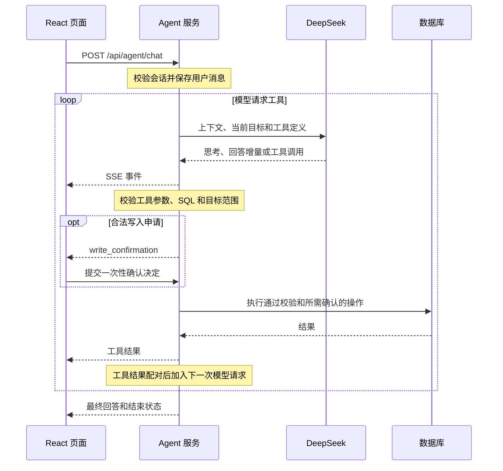

# SQL Studio 数据库 Agent

构建 `sql-studio-frontend` 后，从 `sql-studio-backend` 运行 `go run main.go`，打开默认 18080 页面。点击工作区顶栏的「AI 助手」进入，也可直接打开 `/agent`。点击助手顶栏的「工作区」返回 `/`。页面使用历史路由，支持刷新和浏览器前进、后退；开发时 Vite 的同源地址也使用相同路径。

## 一条消息的执行链路

前端通过 fetch 发送 `{sessionId,message,mode}`，按 SSE 读取响应。模型到 Go、Go 到页面是两条独立的流：Go 除了转发模型内容，还产生工具状态、确认和结束事件。模型申请调用工具，实际执行始终由后端校验和调度。

每次送模包含系统提示、当前目标、保留的上下文和工具定义；工具结果按调用 ID 与原调用配对，保留思考字段及近期完整轮次。模型与 Key 来自共享 AI 配置，不在 Agent 内维护第二份凭据。模型流结束标记和调用参数完整后才进入工具分派，拒绝未知工具、未知参数字段和无效 SQL。

主要入口为 [前端流式请求](../sql-studio-frontend/src/agent/services/chat/index.ts)、[Gin 流式入口](../sql-studio-backend/internal/httpapi/agent_stream.go)、[对话编排](../sql-studio-backend/internal/modules/agent/service.go)、[工具分派](../sql-studio-backend/internal/modules/agent/tools.go)与[模型传输](../sql-studio-backend/internal/deepseek/agent/stream.go)。

| 工具 | 职责 |
| --- | --- |
| list_connections | 发现已保存的连接 ID、名称和引擎 |
| list_databases | 在已发现连接内读取可访问数据库 |
| use_database | 复查访问能力并设置会话目标 |
| list_tables | 列出目标中的表和视图 |
| describe_table | 获取表字段及备注 |
| query_readonly | 执行目标内的受限只读 SQL，最多 100 行 |
| execute_write | 校验目标与写入策略，经逐次确认后执行 |

工具在同一个 Go 进程内调用业务模块，`use_database` 只设置会话目标。连接名、字段备注、数据库值和工具结果均按不可信内容处理，不能替代工具定义或执行策略。

## 界面

聊天界面使用 @ant-design/x 2.5.0 的 Conversations、Bubble、Sender 和 Think。空列表及删除最后一条会话后会创建并选中默认会话。默认标题随界面语言显示「新建会话」或「New chat」。历史支持重命名和确认删除，手动名称始终按原文显示。右上角「系统设置」提供 DeepSeek 配置，输入框底部的模型菜单用于切换模型。工作区与助手共用 AI 配置，保存、移除配置和窗口回焦会刷新助手的配置状态。模式、模型与发送按钮位于输入区底部。Enter 发送，Shift+Enter 换行，中文输入法确认候选时保留在输入阶段。组件参考见[Ant Design X](https://github.com/ant-design/x)与[Sender 接口](https://ant-design-x.antgroup.com/components/sender)。

相邻的思考与执行步骤放在同一个折叠区，展开后按原顺序显示。展开状态随会话布局保存。结果独立展示表格，保留重复列、精确数值文本、NULL、分页和SQL预览。亮暗/跟随系统复用SQL Studio全局主题。内容区可连续上下滚动，虚拟窗口最多挂载 5 轮。滚到窗口中段时提前挂载一轮并保留阅读位置，快速滚到未挂载区域时短暂显示加载提示。左侧刻度和问题搜索可直接定位，离开底部时在聊天区右下侧显示主题主色的「回到底部」箭头。新提问回到最新轮，浏览历史只使用已读取的会话。

`reasoning_delta` 展示思考片段，`tool_start/tool_result` 展示执行步骤，`answer_delta/answer` 展示回答，`write_confirmation/continue_confirmation` 展示确认卡片。前端校验二维表格的列和行结构后渲染，保留数字字符串、NULL 和重复列名；支持 JSON 结果和合法 Markdown 表格。流式表格未完整时显示整理状态，结束后仍不完整则提供原文，不补造数据。SQL 代码只读展示，不因回答中出现 SQL 就执行。`done` 只表示 SSE 结束，本轮是否成功还需结合错误、停止事件和会话状态。

## 后端和数据

- modules/agent：上下文、会话、工具白名单和流式编排，只依赖model/agent与消费接口。
- app：Agent复用已保存连接配置，使用独立引擎客户端和metadata实例；query通过WithExecutor隔离工作台连接开关、取消及请求状态，不在进程内绕行HTTP。SQL窗口与Agent仍共用4个查询并发槽位，Agent读取固定allowWrite=false、limit=100；完全访问写入逐次确认后才使用allowWrite=true。
- deepseek/agent：官方思考SSE和工具调用传输。SQL续写/优化保留现有deepseek客户端，共用同一ai配置；没有第二份运行时Key配置。
- agentstate：状态目录下的 `agent/conversations/` 保存会话索引、版本清单和内容块，`agent/layout.json` 保存布局；恢复不调用模型/数据库。完整原文与送模上下文分离。

Agent 有 2 路执行名额，接收问题前检查，等待确认时释放，同意后重新获取。每轮有 180 秒执行预算，等待确认时暂停计时。按 100 万窗口采用 70 万保守输入估算。摘要处理较早的完整轮次，保留近期完整工具配对和 reasoning_content。工具结果的 32 KiB 确认阈值与 256 KiB 上限分别用于征求送模同意和限制结果体积。SSE 路由每 10 秒发送心跳，断开时取消执行并尝试最终保存。

输入按 UTF-8 字节计算。超过 64 KiB 至 256 KiB 时先确认，超过 256 KiB 时保留编辑框原文并提示分段。工具结果超过 32 KiB 时，确认后才将它发给模型。压缩上下文也需先确认。列库时读取失败的连接在本轮自动跳过。其他工具失败时，Agent 将警告和已取得的结果交回模型，并跳过同批后续工具。模型可在已确认范围内重新规划一次只读操作。写入失败或重新规划后再次失败时，模型直接总结。取消和会话处理错误仍结束本轮。

Agent的每次数据库操作使用独立物理连接，成功、失败或取消后在返回前释放，不等到整轮聊天结束。工作台连接/数据库的打开关闭不影响Agent，也不被Agent操作改变；会话只保存目标和发现记录，不持有数据库连接。等待模型生成和写入确认期间不保留数据库连接，下一次操作按当前配置重新建立。

接口位于/api/agent，见[API](API.md)。Agent布局与SQL工作区布局独立，但共用同一Go进程和全局外观。API Key只由后端读取，前端不回填、不写浏览器持久化；存储使用 `ai-models` 分区。

## 操作模式与确认

POST /api/agent/chat 接收 mode（readonly默认，write为完全访问模式，允许非删除数据及结构操作）。任何模式拒绝DELETE/DROP/TRUNCATE/REPLACE及删除性结构操作；删除仅提供命令及风险提示，不自动执行。刷新和往返工作台恢复上次确认的模式。支持单条INSERT/UPDATE/CREATE/ALTER/COMMENT及表达式和子查询；多语句、存储程序、动态SQL不执行，以防绕过删除限制；取消不保证回滚。查询回答提示生成真实二维JSON表格，前端校验后展示，支持导出当前已加载结果xlsx，截断明确提示。

写入工具通过 `write_confirmation` SSE 事件暂停。当前回复下方的确认卡片显示连接、数据库、涉及对象和完整 SQL。点击确认或取消时，前端向 `POST /api/agent/write-confirmation` 提交 `{approvalId,allow}`。后端将一次性 ID 绑定本次目标和 SQL，最多等待 5 分钟。等待期间暂停执行计时。拒绝、超时、断开或停止均结束确认，历史只恢复展示内容。

Agent SQL防线：sqlpolicy.go在工具层及app进程适配层校验单语句、读取类型、普通表达式函数及目标范围；禁止USE/会话设置、锁/等待、文件操作、未知存储/UDF函数、删除性函数及管理账户/扩展/服务器配置。MySQL/MariaDB限定当前数据库，PostgreSQL保留当前物理库内schema限定名，跨库函数不允许。完全访问仍支持非删除DDL、表达式/子查询及PostgreSQL ON CONFLICT DO UPDATE/NOTHING。确认对象由同一词法扫描提取全部源/目标对象，不再仅正则提取首个名称。

此检查是保守的受支持SQL子集，不是完整SQL解析器或数据库权限沙箱；未知函数应改写或由用户自行审阅执行。既有触发器、外键级联、函数重载、运算符、视图规则、FDW与数据库权限配置仍可能影响实际行为，生产环境需使用最小权限并审查这些配置；不宣称静态规则能阻止所有数据库内间接副作用。普通SQL工作区继续沿用原有能力。

## 会话恢复

保存时合并流式片段，完整回答替换同阶段临时回答。当前 v2 会话按 32 条消息或事件分片，恢复时按页校验 `revision` 和 `eventVersion`。中断状态首次恢复后持久化。摘要上限 2000 字符，摘要请求输出上限 4096 token；正式聊天的单次模型输出上限为 16,384 token。预算估算包含本轮工具与权限提示。

用户停止时，AbortController 和请求 context 将取消传递到模型请求、确认等待及数据库驱动，后端尝试保存已取得的片段。已执行写入不会随停止自动撤销。会话文件和布局目录见 [用户状态](USER_STATE.md)，接口字段及 SSE 约定见 [API](API.md)。
