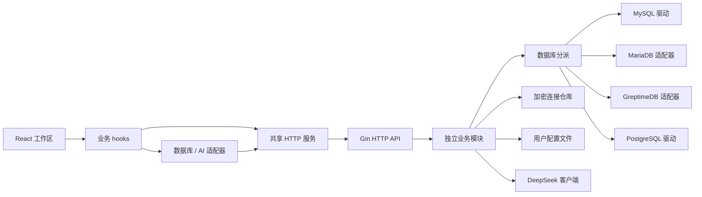

# SQL Studio 项目框架

## 技术栈与目录

前端使用 Vite、React、TypeScript、Ant Design 和 SCSS，SQL 编辑器使用 CodeMirror。后端为 Go Gin 模块化单体，支持 MySQL、MariaDB、PostgreSQL / PolarDB PostgreSQL 与 GreptimeDB。前端包管理使用 pnpm。

```text
SQL-Studio/
├─ sql-studio-frontend/
│  ├─ src/App.tsx             主题、语言和页面装配
│  ├─ src/pages/workspace/    工作区组件、状态与业务 hooks
│  ├─ src/services/           HTTP 接口
│  ├─ src/databases/mysql/    MySQL SQL、补全、对象与数据操作
│  ├─ src/databases/mariadb/  MariaDB 方言与兼容适配
│  ├─ src/databases/greptimedb/ GreptimeDB 连接配置、补全和查询
│  ├─ src/databases/postgresql/ PostgreSQL 方言、补全与数据编辑
│  ├─ src/agent/              数据库 Agent 页面与会话
│  ├─ src/ai/                 AI 服务商适配器
│  ├─ src/constant/          共享只读定义
│  ├─ src/typings/           跨模块类型契约
│  ├─ src/utils/              无页面依赖工具
│  ├─ src/app.scss            基础全局、Ant Design 覆盖及必要选择器
│  ├─ swagger.html            独立 Swagger UI 构建入口
│  └─ tests/                  Node 回归测试
├─ sql-studio-backend/
│  ├─ main.go                  单进程启动入口
│  ├─ internal/app/           实现注入、HTTP 和资源生命周期
│  ├─ internal/httpapi/       Gin 路由及内嵌 OpenAPI 契约
│  ├─ internal/modules/       连接、元数据、查询、配置、工作区和 Agent
│  ├─ internal/model/         跨层数据契约
│  ├─ internal/mysql/         MySQL 驱动、元数据及执行
│  ├─ internal/mariadb/       MariaDB 引擎及独立会话
│  ├─ internal/greptimedb/    GreptimeDB 引擎及独立会话
│  ├─ internal/postgresql/    PostgreSQL 驱动、schema 元数据及执行
│  ├─ internal/database/      引擎分派
│  ├─ internal/connection/    AES-GCM 连接仓库
│  ├─ internal/statefile/     用户分区 JSON 和修订保护
│  ├─ internal/deepseek/      AI HTTPS 传输
│  └─ tests/                  架构与可选数据库集成测试
├─ sql-studio-electron/        独立 Electron 桌面壳、进程管理与安装包构建
└─ docs/                     当前项目文档
```

## 调用与数据流



图中依赖由 app 注入，各业务模块不直接导入兄弟模块或具体实现。页面只组合组件，异步状态归属所属 hook。引擎专属 SQL 和类型在各自引擎目录内，通用 UI 通过适配器调用。

页面采用历史路由：`/` 是 SQL 工作区，`/agent` 是 AI 助手。useAppSection 以 pushState 和 popstate 同步 React 页面与浏览器历史，工作区保持挂载以保留未保存内容。Vite SPA 模式处理开发入口，Go 显式将两条路径映射到 index.html，Electron 加载同源网页，因此刷新与直接访问使用相同入口。

每次查询绑定发起页面和连接。前端顺序拆分多语句，后端每次执行单语句，使用共享并发预算并传递取消。旧请求不得覆盖新范围。SQL 窗口显式允许查询和写入，元数据及表数据预览沿用默认读取请求。取消不会回滚已经完成的写入。

## SQL 工作区核心流程

1. 每页独立持有连接、数据库、Schema、SQL 草稿和最新输出。运行优先使用选区，否则使用完整草稿；右键运行只使用当次捕获的选区，空选区不回退整页执行。
2. 引擎适配器识别字符串、注释等边界后切分脚本，前端按序调用单语句查询 API。MySQL、MariaDB 和 GreptimeDB 成功执行 USE 后，后续请求显式使用更新后的库。PostgreSQL 使用独立的数据库和 Schema 范围。
3. 每条响应写回发起页面的当前运行。失败或取消停止后续语句，保留已完成结果；切换页面或变更范围后，旧响应不能覆盖新状态。各请求不共享事务、SET 或临时表会话。
4. 数据集进入结果标签，无数据列的回执进入消息与摘要。筛选、排序、分页和 CSV 导出针对已加载数据，保留重复列、NULL 和精确数值文本。刷新使用该结果原来的 SQL 与范围，写入语句也会再次执行。
5. 表数据页将单元格和新行修改保留为草稿，显式保存时逐项提交；已有行更新、删除要求完整主键，更新还核对原值和表结构。失败保留剩余草稿并报告已成功数量，整批不保证事务原子性。视图和不支持字段不能直接编辑。
6. 页面草稿和结果通过工作区索引与分片保存，恢复不执行 SQL，未完成运行标记为中断；未提交的数据编辑不承诺刷新后恢复。文件格式与冲突规则见 [用户状态](USER_STATE.md)。

SQL 补全与美化使用共享默认模型。页面、范围或模型变化时取消旧请求，应用建议前再次核对原文档及范围；生成 SQL 只作为建议，不自动执行。SQL、注释和选取的库表结构会作为模型上下文，数据库密码及查询结果不进入 SQL 辅助请求。具备工具执行能力的 [数据库 Agent](AGENT.md) 使用独立的权限和逐次确认流程。

实现入口见 [工作区业务编排](../sql-studio-frontend/src/pages/workspace/hooks/useWorkspace/README.md)、[查询执行](../sql-studio-frontend/src/pages/workspace/hooks/useQueryExecution/README.md)、[表数据编辑](../sql-studio-frontend/src/pages/workspace/hooks/useDataEditing/README.md)与[数据库适配器](../sql-studio-frontend/src/databases/README.md)。

## 持久化与运行

连接密码由后端 AES-GCM 加密后保存在配置目录，默认路径为 `~/.sql-studio/state/`。密钥随连接文件备份。该目录的分区 JSON 保存工作区、历史、主题和 AI 配置。配置使用版本号与修订号，拒绝冲突覆盖。工作区不含连接密码，恢复不自动执行 SQL。AI Key 仅后端保存，公开响应脱敏，SQL 续写和优化只生成建议。Agent 工具执行遵守 [操作模式与确认规则](AGENT.md#操作模式与确认)。

开发时 Vite 15173 将 /api 同源代理到 Go 18080。构建后 Go 同时提供网页、Swagger 页面与 API，无额外服务进程。启动见 [项目 README](../README.md)，包依赖细节见 [后端架构](BACKEND_ARCHITECTURE.md)。

[Electron 桌面项目](../sql-studio-electron/README.md) 的调试窗口加载开发者手动启动的 Vite 和 Go 服务。打包版由主进程启动随包 Go 服务、加载构建后的前端页面，并管理服务退出。桌面版和独立 Go 服务默认共用用户主目录下的 `.sql-studio/state/`。
