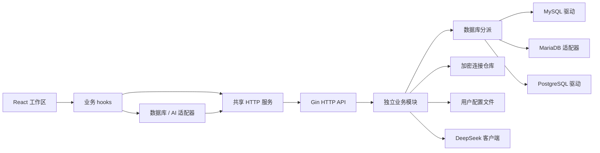

# SQL Studio 项目框架

## 技术栈与目录

前端使用 Vite + React + TypeScript + Ant Design + SCSS，SQL 编辑器使用 CodeMirror；后端使用 Go + Gin 模块化单体，数据库支持 MySQL、MariaDB 和 PostgreSQL / PolarDB PostgreSQL。前端包管理使用 pnpm。

```text
SQL-Studio/
├─ sql-studio-frontend/
│  ├─ src/App.tsx             主题、语言和页面装配
│  ├─ src/pages/workspace/    工作区组件、状态与业务 hooks
│  ├─ src/services/           HTTP 接口
│  ├─ src/databases/mysql/    MySQL SQL、补全、对象与数据操作
│  ├─ src/databases/mariadb/  MariaDB 方言与兼容适配
│  ├─ src/databases/postgresql/ PostgreSQL 方言、补全与数据编辑
│  ├─ src/agent/              数据库 Agent 页面与会话
│  ├─ src/ai/                 AI 服务商适配器
│  ├─ src/constant/          共享只读定义
│  ├─ src/typings/           跨模块类型契约
│  ├─ src/utils/              无页面依赖工具
│  ├─ src/app.scss            基础全局、Ant Design 覆盖及必要选择器
│  ├─ swagger.html            独立 Swagger UI 构建入口
│  └─ tests/                  Node 回归测试
├─ sql-studio-backend/
│  ├─ main.go                  单进程启动入口
│  ├─ internal/app/           实现注入、HTTP 和资源生命周期
│  ├─ internal/httpapi/       Gin 路由及内嵌 OpenAPI 契约
│  ├─ internal/modules/       连接、元数据、查询、配置、工作区和 Agent
│  ├─ internal/model/         跨层数据契约
│  ├─ internal/mysql/         MySQL 驱动、元数据及执行
│  ├─ internal/mariadb/       MariaDB 引擎及独立会话
│  ├─ internal/postgresql/    PostgreSQL 驱动、schema 元数据及执行
│  ├─ internal/database/      引擎分派
│  ├─ internal/connection/    AES-GCM 连接仓库
│  ├─ internal/statefile/     用户分区 JSON 和修订保护
│  ├─ internal/deepseek/      AI HTTPS 传输
│  └─ tests/                  架构与可选数据库集成测试
├─ sql-studio-electron/        独立 Electron 桌面壳、进程管理与安装包构建
└─ docs/                     当前项目文档
```

## 调用与数据流



图中依赖由 app 注入，各业务模块不直接导入兄弟模块或具体实现。页面只组合组件，异步状态归属所属 hook。引擎专属 SQL 和类型在各自引擎目录内，通用 UI 通过适配器调用。

每次查询绑定发起页面和连接；前端顺序拆分多语句，后端每次只执行单语句，使用共享并发预算并传递取消。旧请求不得覆盖新范围。MySQL/MariaDB/PostgreSQL SQL 窗口均显式允许查询和写入；元数据及表数据预览沿用默认读取请求，对象/数据保存显式写入；取消不能视为已回滚。

## 持久化与运行

连接密码由后端 AES-GCM 加密后保存在配置目录，默认路径为 `~/.sql-studio/state/`。密钥随连接文件备份。该目录的分区 JSON 保存工作区、历史、主题和 AI 配置。配置使用版本号与修订号，拒绝冲突覆盖。工作区不含连接密码，恢复不自动执行 SQL。AI Key 仅后端保存，公开响应脱敏，SQL 续写和优化只生成建议。Agent 工具执行遵守 [操作模式与确认规则](AGENT.md#操作模式与确认)。

开发时 Vite 15173 将 /api 同源代理到 Go 18080。构建后 Go 同时提供网页、Swagger 页面与 API，无额外服务进程。启动见 [项目 README](../README.md)，包依赖细节见 [后端架构](BACKEND_ARCHITECTURE.md)。

[Electron 桌面项目](../sql-studio-electron/README.md) 的调试窗口加载开发者手动启动的 Vite 和 Go 服务。打包版由主进程启动随包 Go 服务、加载构建后的前端页面，并管理服务退出。桌面版和独立 Go 服务默认共用用户主目录下的 `.sql-studio/state/`。
