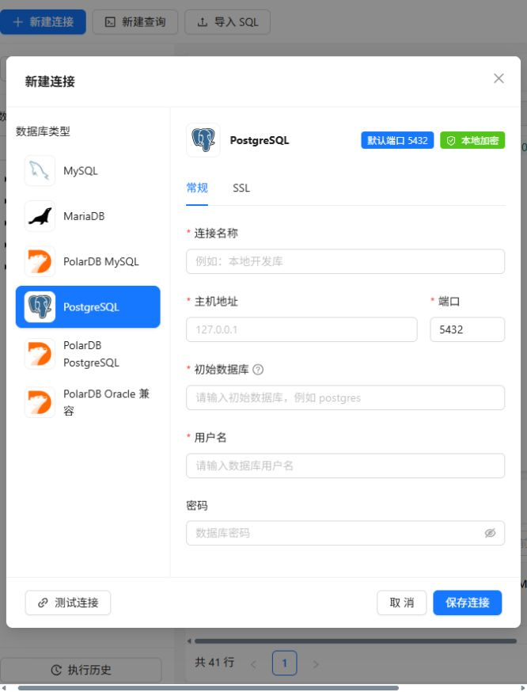

# 数据库连接与支持范围

## 产品类型和协议

| 界面类型 | API type | 驱动协议 | 默认端口 | 首次连接数据库 |
| --- | --- | --- | --- | --- |
| MySQL | `mysql` | MySQL | 3306 | 可不填 |
| MariaDB | `mariadb` | MySQL 兼容 | 3306 | 可不填 |
| PolarDB MySQL | `polardb-mysql` | MySQL 兼容 | 3306 | 可不填 |
| PostgreSQL | `postgresql` | PostgreSQL / pgx | 5432 | 默认 `postgres`，可修改 |
| PolarDB PostgreSQL | `polardb-postgresql` | PostgreSQL / pgx | 5432 | 填写实际有权访问的数据库 |
| PolarDB Oracle 兼容 | `polardb-oracle` | PostgreSQL / pgx | 5432 | 填写实际有权访问的数据库 |

用户所指的 PolarDB 为 **PostgreSQL / 兼容 Oracle 版**，该类型已单独实现 PostgreSQL 协议路径，不使用 MySQL 驱动冒充。Oracle 兼容版的连接方式依据[阿里云官方说明](https://www.alibabacloud.com/help/en/polardb/polardb-for-oracle/connect-to-polardb)；它不是 Oracle Database 原生协议连接。MariaDB 使用 MySQL 兼容客户端协议，参考 [MariaDB 官方兼容说明](https://mariadb.com/docs/release-notes/community-server/about/compatibility-and-differences/mariadb-vs-mysql-compatibility)。PolarDB MySQL 参见[官方连接说明](https://www.alibabacloud.com/help/en/polardb/polardb-for-mysql/user-guide/connect-to-polardb/)。

产品类型决定协议和界面默认项，服务返回实际版本；选择类型不会转换任意 SQL 方言。若云实例使用非默认端口或账号，请填写实际值。

## 创建连接

连接窗口左侧选择类型，右侧「常规」填写名称、主机、端口、用户名和密码。PostgreSQL 系列还需填写初始数据库，用于首次连接与列出可访问数据库；工作区可继续切换其他有权访问的库。

布局遵循前端 design 参考图：标题、类型侧栏、表单和底部按钮分区。类型标题旁显示默认端口 Tag；必填字段就地反馈错误，连接成功显示状态标签与版本，失败保留完整错误原因。

「SSL」启用 TLS 后，MySQL 使用验证模式，PostgreSQL 使用 `verify-full`，检查证书链和主机名。默认不加密以兼容已有本机连接；尚未支持自定义 CA 文件、客户端证书和 SSH 隧道。

密码由后端 AES-256-GCM 加密保存，编辑留空保留旧密码；连接类型、初始库和 TLS 开关随配置保存。历史缺少 type 的连接按 MySQL 处理，旧密钥和密文格式无需迁移。

[暗黑主题连接窗口](connection-dialog-dark.png)

## 库、Schema 与表

- 运行 SQL 按钮旁的库/表下拉框与左侧树共享列表。范围保存在当前查询标签中，切标签恢复、新建继承；选择库会清空该标签的旧表和 Schema，加载该库的表/视图，表下拉支持搜索。
- MySQL 系列表以名称显示，预览 SQL 使用反引号限定库名和表名。
- PostgreSQL 系列表以 `schema.table` 显示，按名称和 Schema 共同识别。同名表不会互相覆盖；预览 SQL 使用双引号限定 Schema/表名，查询请求携带 Schema 并设置安全转义的 search_path。
- 左侧对象树保持固定，SQL 编辑区填充空间；底部结果可拖动上边缘调整高度、折叠或双击恢复，结果及对象列表各自滚动。字体采用系统和组件默认值，支持亮暗主题与跟随系统，普通文字使用黑/白。

## SQL 与 DDL

两种协议都默认开启数据库只读事务，显式写入模式才自动提交；单次执行一条 SQL，查询 30 秒超时、最多 5,000 行/约 8 MiB 字段内容。

MySQL 返回精确整数和 DECIMAL 文本；PostgreSQL 使用文本结果协议，保留 NUMERIC、BIGINT、日期时间、JSON、数组的服务端文本，NULL 保留为空值，BYTEA 转为 `0x...`。PostgreSQL 支持 `INSERT ... RETURNING` 直接展示返回行；不使用 LastInsertId 获取序列。

MySQL DDL 来自 `SHOW CREATE`。PostgreSQL 视图使用 `pg_get_viewdef`，普通表定义按字段、默认值、约束和独立索引重建，**不是完整 pg_dump**；分区继承、权限、存储参数、过程/包等专有对象不保证完整重建。

## 实际验证

- 真实 MySQL 8.4.10 和独立临时 PostgreSQL 18.6 已做集成回归。
- PostgreSQL 回归覆盖 Schema/表名特殊字符、重复列名、NULL、BIGINT、NUMERIC、BYTEA、只读/CTE 写入拦截、单语句限制、RETURNING、超时、表/视图 DDL 及 Gin 路由。
- 浏览器验证同一库的 `public.sample_rows` 与 `sample.sample_rows` 分别返回正确数据，SQL 使用正确的双引号限定符。
- PolarDB PostgreSQL / Oracle 类型在 PostgreSQL 实例上验证了路由与协议路径；**没有云端 PolarDB 凭据，未进行云实例或 Oracle 专有 PL/SQL 功能验证**。MariaDB 的配置和驱动参数已测，暂无独立 MariaDB 实例联调记录。
- 临时 PostgreSQL 测试集群和浏览器测试连接在验证后清理，不作为应用运行依赖。

测试入口与参数见 [后端 README](../sql-server/README.md)。
